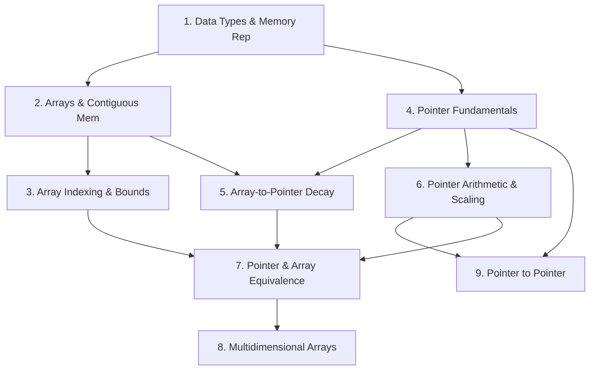

# ConceptIQ — Adaptive Intelligent Tutor for GATE CSE

> An adaptive learning platform for GATE CSE aspirants featuring voice-first reasoning diagnosis, deterministic Bayesian Knowledge Tracing, prerequisite graph traversal, and spaced repetition.

---

## 🎯 System Philosophy & Core Distinction

Unlike conventional chatbots or static quiz applications, **ConceptIQ** enforces a strict separation between three core systems:

```
                  ┌──────────────────────────────────────────────┐
                  │          Student Submission                   │
                  │  (Answer Choice + Wispr Flow Voice Reasoning) │
                  └──────────────────────┬───────────────────────┘
                                         │
                 ┌───────────────────────┴───────────────────────┐
                 │                                               │
                 ▼                                               ▼
    ┌───────────────────────────┐                 ┌───────────────────────────┐
    │  1. Diagnostic Engine     │                 │   Deterministic Evaluator │
    │   (LLM: Gemini / OpenAI)  │                 │    (Backend Answer Key)   │
    ├───────────────────────────┤                 ├───────────────────────────┤
    │ • Speech artifact parsing │                 │ • Exact string/regex norm │
    │ • Misconception detection │                 │ • Pure binary correctness │
    │ • Pedagogical coaching    │                 │ • SOLE authority on obs   │
    └─────────────┬─────────────┘                 └─────────────┬─────────────┘
                  │                                             │
                  │ (Diagnostic Signal)                         │ (is_correct)
                  ▼                                             ▼
    ┌─────────────────────────────────────────────────────────────────────────┐
    │                     2. Knowledge Engine (Standard BKT)                  │
    │  • Bayesian Knowledge Tracing maintains P(L) mastery per concept        │
    │  • Updated strictly using binary correctness — NO arbitrary LLM scores  │
    │  • Exact audit trail recorded per opportunity                           │
    └────────────────────────────────────┬────────────────────────────────────┘
                                         │
                                         ▼
    ┌─────────────────────────────────────────────────────────────────────────┐
    │                     3. Decision Engine (Adaptive Loop)                  │
    │  • Prerequisite DAG Traversal (Remediation if parent mastery < 0.50)    │
    │  • Leitner Spaced-Repetition Scheduler (Boxes 1..5)                     │
    │  • Difficulty Escalation (0.1 easy -> 1.0 hard)                         │
    │  • Generates transparent selection rationale based on real data         │
    └─────────────────────────────────────────────────────────────────────────┘
```

1. **Diagnostic Engine (LLM-based)**:
   - Understands *why* the student answered incorrectly and classifies mental misconceptions.
   - Built to handle spoken reasoning from **Wispr Flow** dictation (speech hesitations, fillers like *"um/like"*, self-corrections, and spoken code syntax like *"star p"* or *"arr of i"*).
   - Strictly prohibited from determining answer correctness or generating quantitative mastery probabilities.
2. **Knowledge Engine (Standard BKT)**:
   - Standard Bayesian Knowledge Tracing maintains calibrated concept mastery ($0.0 - 1.0$).
   - Evaluated strictly on deterministic backend binary observations.
3. **Decision Engine (Prerequisite DAG + Leitner Scheduler)**:
   - Traverses the GATE CSE concept dependency graph.
   - Selects subsequent questions dynamically with a human-readable selection rationale.

---

## 📐 Mathematical Formulation: Bayesian Knowledge Tracing (BKT)

ConceptIQ implements Corbett & Anderson's standard Bayesian Knowledge Tracing model with per-concept calibrated parameters:
- $P(L_0)$: Initial probability of knowing the concept.
- $P(T)$: Probability of transitioning from unlearned to learned state at each opportunity.
- $P(G)$: Probability of guessing correctly without knowing the concept.
- $P(S)$: Probability of slipping (incorrect answer despite knowing the concept).

### 1. Bayesian Posterior Update:
$$\text{If Correct: } P(L_t \mid \text{obs}=1) = \frac{P(L_t) \cdot (1 - P(S))}{P(L_t) \cdot (1 - P(S)) + (1 - P(L_t)) \cdot P(G)}$$

$$\text{If Incorrect: } P(L_t \mid \text{obs}=0) = \frac{P(L_t) \cdot P(S)}{P(L_t) \cdot P(S) + (1 - P(L_t)) \cdot (1 - P(G))}$$

### 2. Knowledge Transition Step:
$$P(L_{t+1}) = P(L_t \mid \text{obs}) + (1 - P(L_t \mid \text{obs})) \cdot P(T)$$

---

## 🗺️ Curriculum Scope: C Programming (Arrays & Pointers)

The curriculum encompasses 9 core GATE CSE concepts connected via a verified **Directed Acyclic Graph (DAG)** with 22 calibrated questions and 8 cataloged misconceptions:



### Known GATE CSE Misconceptions Cataloged:
1. `BYTE_INCREMENT_FALLACY`: Assuming `ptr + 1` increments the raw memory address by 1 byte instead of `sizeof(*ptr)`.
2. `ARRAY_NAME_IS_POINTER_VARIABLE`: Confusing an array identifier with a modifiable pointer variable (`arr++` vs `ptr++`).
3. `SIZEOF_ARRAY_EQUALS_POINTER_SIZE`: Believing `sizeof(arr)` always returns pointer size (4 or 8 bytes) rather than the allocated block.
4. `PRECEDENCE_DEREF_AND_POSTINCREMENT`: Evaluating `*p++` as `(*p)++` rather than `*(p++)`.
5. `COMMUTATIVITY_OF_INDEXING_DISBELIEF`: Assuming `2[arr]` is invalid syntax in C (failing to recognize standard `*(2 + arr)` equivalence).
6. `CONFUSING_ARRAY_OF_POINTERS_WITH_POINTER_TO_ARRAY`: Treating `int *arr[10]` identically to `int (*arr)[10]`.
7. `DOUBLE_POINTER_EQUALS_2D_ARRAY`: Assuming `int**` is compatible with a 2D contiguous array `int arr[3][3]`.
8. `OUT_OF_BOUNDS_COMPILER_ERROR_BELIEF`: Expecting runtime or compile-time bounds checking in C.

---

## ⚡ Quickstart

### 1. Requirements
- Python 3.10+
- SQLite with WAL mode enabled

### 2. Installation
```bash
git clone https://github.com/TheyCallMeAnirban/conceptIQ.git
cd conceptIQ

# Install minimal pinned dependencies
pip install -r backend/requirements.txt
```

### 3. Environment Configuration
Create a `.env` file in the project root:
```env
LLM_PROVIDER=gemini
GEMINI_API_KEY=your_gemini_api_key_here
DATABASE_URL=sqlite:///./conceptiq.db
```
*(If no API key is provided, the platform automatically runs on its labelled `deterministic_fallback` without crashing).*

### 4. Seed the Database
```bash
python -m backend.app.seed.seed_db
```

### 5. Run the Server
```bash
uvicorn backend.app.main:app --host 127.0.0.1 --port 8000 --reload
```

---

## 🧪 Testing & Verification

### Interactive Testing Tool (CLI)
Test student voice reasoning directly from your terminal:
```bash
# Test a student making an intentional conceptual error:
python backend/demo_cli.py Q_ARITH_01 "Option A" "Um, so ptr holds 0x3000, and adding 2 just adds 1 byte per step, so it becomes 0x3002."

# Test a student giving sound reasoning:
python backend/demo_cli.py Q_ARITH_01 B "Since int is 4 bytes, ptr+2 scales by 2*4=8 bytes to 0x3008."
```

### Interactive OpenAPI / Swagger UI
Open **[http://127.0.0.1:8000/docs](http://127.0.0.1:8000/docs)** to test all REST endpoints:
- `POST /api/v1/sessions/start`: Begin or resume an adaptive diagnostic session.
- `POST /api/v1/sessions/submit`: Submit student choice and voice transcript.
- `GET /api/v1/learners/{id}/mastery`: Query real-time knowledge graph probabilities.
- `GET /api/v1/learners/{id}/due-reviews`: Query spaced-repetition revision queue.
- `GET /api/v1/analytics/misconceptions`: Class-wide vulnerability heatmap for teachers.

### Run Automated Pytest Suite
```bash
python -m pytest backend/tests -v
```

### Generate Coverage Report
```bash
python -m pytest --cov=backend/app --cov-branch --cov-report=term-missing backend/tests
```
- **Total Tests**: 47 passing tests
- **Overall Code Coverage**: 86% line coverage
- **BKT Engine**: 97% coverage
- **Scheduler**: 100% coverage
- **DAG Validator**: 96% coverage
- **Answer Evaluator**: 93% coverage

---

## 🏛️ Project Structure

```text
conceptIQ/
├── backend/
│   ├── app/
│   │   ├── api/v1/
│   │   │   ├── router.py                  # API v1 centralized route index
│   │   │   └── endpoints/
│   │   │       ├── sessions.py            # Session start & attempt submission
│   │   │       ├── learners.py            # Learner mastery & due reviews
│   │   │       ├── concepts.py            # Concept curriculum & DAG topology
│   │   │       ├── questions.py           # Question bank retrieval
│   │   │       └── analytics.py           # Class-wide misconception analytics
│   │   ├── core/
│   │   │   ├── config.py                  # Settings, Pydantic settings config
│   │   │   └── database.py                # SQLite WAL engine & sessionmaker
│   │   ├── domain/
│   │   │   ├── bkt.py                     # Standard Bayesian Knowledge Tracing
│   │   │   ├── dag.py                     # Kahn's topological sort & cycle check
│   │   │   ├── evaluator.py               # Deterministic correctness evaluator
│   │   │   ├── scheduler.py               # Leitner 5-box spaced-repetition scheduler
│   │   │   └── schemas/                   # Strict Pydantic contracts (extra='forbid')
│   │   │       ├── diagnosis.py
│   │   │       ├── selection.py
│   │   │       └── session.py
│   │   ├── models/                        # SQLAlchemy 2.0 ORM Declarative models
│   │   ├── seed/
│   │   │   ├── c_curriculum_data.py       # 9 concepts, 12 edges, 22 questions, 8 misconceptions
│   │   │   └── seed_db.py                 # Idempotent database seeder
│   │   ├── services/
│   │   │   ├── llm_diagnostician.py       # Gemini 2.5 Flash / OpenAI / Fallback
│   │   │   ├── question_selector.py       # Multi-factor adaptive selector
│   │   │   └── learning_loop.py           # Single-transaction atomic orchestrator
│   │   └── main.py                        # FastAPI application entrypoint
│   ├── demo_cli.py                        # Interactive student reasoning simulator
│   ├── requirements.txt                   # Minimal pinned dependencies
│   └── tests/                             # 47 unit and integration tests
├── .env.example
├── .gitignore
└── README.md
```

---

## 🔒 Security & Reliability Principles

1. **Deterministic Authority**: The LLM's diagnosis never dictates mathematical mastery or whether an answer is marked correct.
2. **Transaction Atomicity**: Attempt persistence, BKT state deltas, Leitner box transitions, and session state are executed in a single atomic database transaction with full rollback protection.
3. **Graceful Degradation**: If external AI APIs time out or credentials are missing, the system automatically falls back to deterministic analysis, labelling its output explicitly as `deterministic_fallback`.
